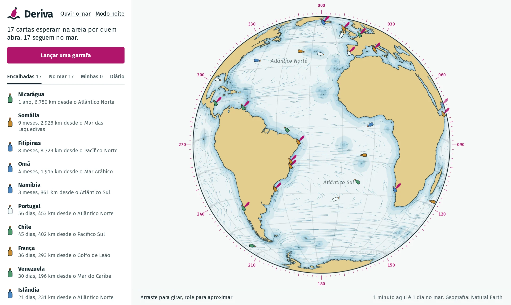
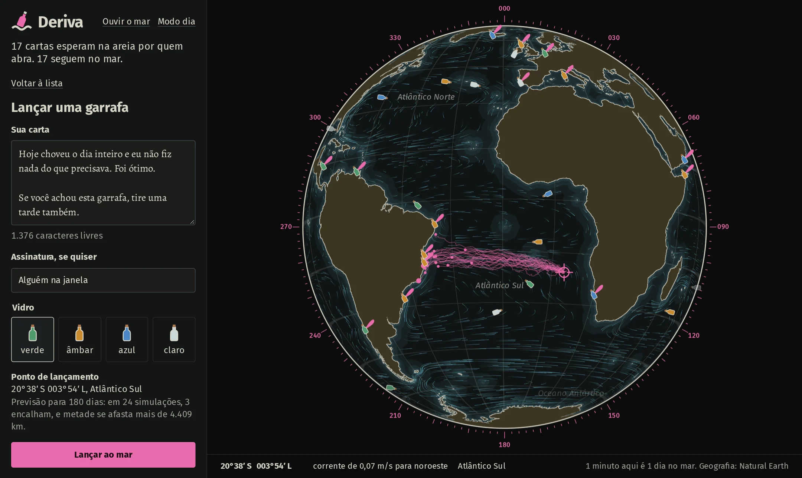
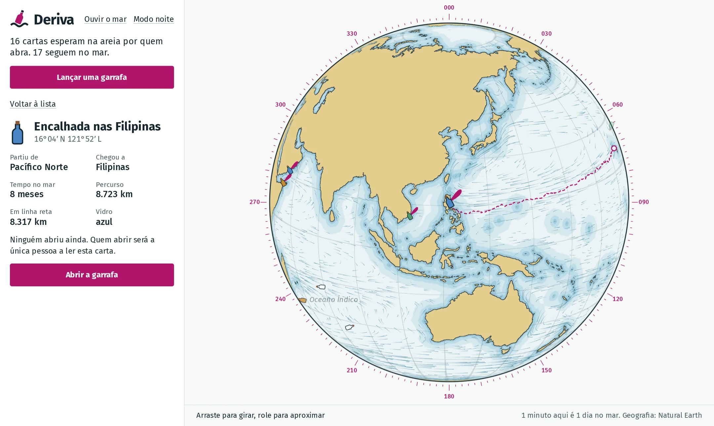
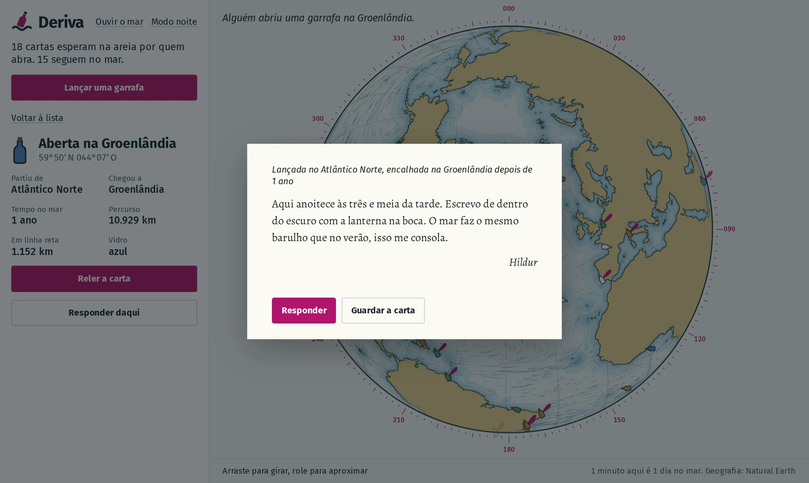

<div align="center">


# Deriva, o correio do mar

Escreva uma carta, escolha um ponto do oceano e lance a garrafa.<br>
O mar decide onde ela encalha. Só uma pessoa pode abri-la.

<picture>
  <source media="(prefers-color-scheme: dark)" srcset="docs/noite.webp">
  
</picture>

</div>

Fiz o Deriva por diversão. É um mar que continua andando: **um minuto aqui é um dia lá**, e uma garrafa
pode levar mais de um ano para achar uma praia.

## Como é

**Você escreve e escolhe onde lançar.** Antes de soltar a garrafa, o mapa mostra 24 rumos que ela pode tomar
nos próximos seis meses.



**Ela vai embora.** Dá para acompanhar o caminho de cada uma. Esta saiu do meio do Pacífico Norte e, oito meses
depois, deu nas Filipinas.



**Alguém acha, abre e lê.** Uma carta, um leitor. Quem abriu pode responder, e a resposta também vai pelo mar:
por um ano de mar, só quem escreveu a primeira carta pode abri-la.



## Detalhes de que eu gosto

- Nenhuma corrente foi desenhada à mão. O programa calcula como o vento empurra a água, e a Corrente do Golfo
  aparece sozinha.
- O botão "Ouvir o mar" faz o que promete.
- À noite, o globo escurece como a tela de navegação de um navio.
- Não tem cadastro, e o texto de uma carta só chega a quem a escreveu ou a abriu.
- O mar já começa com cartas. São todas inventadas, do Davi de 9 anos que quer saber se aí tem tubarão
  à costureira que guarda um retalho de cada vestido de noiva que fez.

## Para rodar

Precisa de PHP 8.3+ com `ext-mongodb`, Composer, MongoDB 8 e Node.

```bash
composer install
cp .env.example .env
php artisan key:generate
npm install && npm run build
./deriva
```

Depois é só abrir <http://localhost:8010>. Ainda não há moderação das cartas, então ele foi feito para rodar em
casa ou entre amigos.

---

Feito com Laravel, MongoDB, WebGL e JavaScript. Mapas do [Natural Earth](https://www.naturalearthdata.com/), em domínio público.
